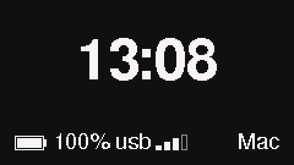
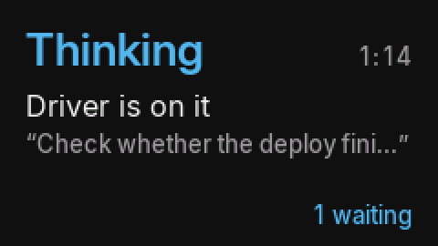

# talkstick

**Hold a button, say something, get the answer back.** talkstick turns an [M5StickS3](https://docs.m5stack.com/en/core/StickS3)
into a wireless push-to-talk remote for whatever you want to talk to: an agent, a script, a webhook, a chat thread.
The stick streams your voice over WiFi to a small daemon on your computer, the daemon transcribes it, hands the text
to a command or URL you choose, and sends the reply back to the stick's screen.

<p align="center">
  
  
  
  
</p>

```
 M5StickS3                         your Mac (or Linux box)
 ┌──────────────┐  WiFi, TCP 47820  ┌──────────────────────────────────────────────┐
 │ hold A: mic  │ ───────────────▶  │ talkstick daemon                             │
 │ 16 kHz PCM   │   M5R1 frames     │  ├ engine:   whisper.cpp | command | (Wispr)  │
 │              │                   │  ├ delivery: command | webhook | print        │
 │ screen:      │ ◀───────────────  │  └ on_reply: optional command (phone, notify) │
 │ sent, reply  │   status lines    └──────────────────────────────────────────────┘
 └──────────────┘
```

Nothing leaves your network unless your delivery command sends it somewhere. The default engine is local
whisper.cpp and the default delivery just prints the text.

## What it does

- **Hold A** to talk. The mic runs while the stick is awake, so recording starts the instant you press; after a
  deep-sleep wake the screen says *Wait* for about a second until audio flows, then *Listening*.
- **Release** and the stick shows *Sent*, then *Thinking* with the elapsed time, then the reply itself.
- **Tap A** sends a status question you set in the config (for example "one line on what is running").
- **B while talking** cancels. **B otherwise** shows the last reply again and pages through it.
- Quiet, distinct clicks for sent, replied and problems (`sound off` on the serial console mutes them). There is no
  click on press: the speaker shares the codec with the mic, and restarting the mic after a click cost 0.9 s of speech.
- Idle screen: clock (from the daemon, no internet needed), battery, WiFi strength, and whether the daemon is reachable.
- On battery it deep-sleeps when idle and wakes on button A; on USB it stays awake with the screen dimmed.

Every element on screen has one job, listed in [firmware/README-firmware.md](firmware/README-firmware.md#screens-and-what-each-element-is-for).
Colours come from the Okabe-Ito set with clear lightness steps, and every state is also named in words, so the screen
reads the same for colour-blind eyes.

## You need

- An **M5StickS3** (SKU K150). Other M5 sticks have different pins and are not supported.
- A computer on the same WiFi with **Python 3.9+** (stdlib only), **ffmpeg** and **whisper.cpp** (`whisper-cli`) for
  the default engine. macOS is the tested platform; the daemon runs on Linux (Bonjour via Avahi is untested).
- To build firmware: **arduino-cli** and **esptool**.

```sh
brew install arduino-cli whisper-cpp ffmpeg      # macOS
uv tool install esptool                          # or: pipx install esptool
mkdir -p ~/.local/share/talkstick
curl -L -o ~/.local/share/talkstick/ggml-base.en.bin \
  https://huggingface.co/ggerganov/whisper.cpp/resolve/main/ggml-base.en.bin
```

## 1. Flash the stick

```sh
arduino-cli config add board_manager.additional_urls \
  https://static-cdn.m5stack.com/resource/arduino/package_m5stack_index.json
arduino-cli core update-index && arduino-cli core install m5stack:esp32
arduino-cli lib install M5Unified M5GFX M5PM1

mkdir -p ~/.config/talkstick
cp firmware/config.example.env ~/.config/talkstick/firmware.env
chmod 600 ~/.config/talkstick/firmware.env      # then fill in WiFi name, password, fallback host
firmware/build.sh
```

Plug the stick in by USB-C, **hold the power button until the green LED blinks** (download mode), then:

```sh
firmware/flash.sh
```

Not at the stick when it is ready? `firmware/tools/flash-when-ready.sh` waits for download mode, flashes, and can
run a command afterwards. The WiFi password ends up only in the generated header and the image, both outside the
repo in folders created mode 700.

## 2. Run the daemon

```sh
mkdir -p ~/.config/talkstick
cp config.example.json ~/.config/talkstick/config.json
daemon/talkstick serve
```

Hold A and speak: the transcript prints in the daemon's terminal, and the stick shows *Sent* then *Replied*. Test it
without the stick:

```sh
say -o hi.aiff "hello from the stick" && ffmpeg -i hi.aiff -ar 16000 -ac 1 hi.wav   # any 16 kHz mono WAV
daemon/talkstick fake-stick hi.wav localhost      # acts as the stick, prints each status line with timings
daemon/talkstick bench hi.wav                     # transcribe and deliver once, no network
daemon/talkstick fake-stick --watch localhost     # acts as the stick's watch connection: queue, answers, offers
daemon/talkstick status                           # is it up, last five timings, queue and in-flight items, staged update
daemon/talkstick ota ~/.cache/talkstick/build/talkstick.ino.bin   # update the stick over WiFi (needs ota_key_file)
```

To keep it running on macOS, put `daemon/talkstick` somewhere stable and load a launchd agent; a template is in
[examples/t3-driver/talkstick.plist.template](examples/t3-driver/talkstick.plist.template). The first incoming
connection may ask the macOS firewall for permission for the Python that runs it.

## 3. Point it at something

Delivery is a command or a webhook, so anything you can script works.

**A command.** The transcript arrives on stdin. Print `@sent` once it is delivered (the stick shows *Sent*), then
print the reply. Exit 3 means the target is offline. Optionally, between `@sent` and the reply, print `@busy` while
the target is busy with something else and `@running` once it works on this message; the stick shows its place in
the queue.

```json
"delivery": {"type": "command", "command": {"argv": ["/path/to/ask-my-agent.sh"], "timeout": 600}}
```

**A webhook.** The daemon POSTs `{"text", "device", "utterance_id", "dry"}`; answer with `{"reply": "..."}` or plain
text. 503 means offline.

```json
"delivery": {"type": "webhook", "webhook": {"url": "http://127.0.0.1:8080/talk", "timeout": 600}}
```

**After the reply**, `on_reply` can run one more command with the reply on stdin, for example a script that texts
your phone. It runs after the stick already has the reply, so a failure there never hides the answer.

Examples:

- [examples/webhook-echo](examples/webhook-echo): a small stdlib server that answers "you said: ...".
- [examples/t3-driver](examples/t3-driver): sends each message into a [T3 Code](https://t3.codes) agent thread and
  waits for that thread's reply to the exact message, even when the agent is busy.

## Config reference

`$TALKSTICK_CONFIG`, else `~/.config/talkstick/config.json`. Every key with its default is in
[config.example.json](config.example.json); the `_name` keys there document each one.

| Key | Default | What it sets |
|---|---|---|
| `port`, `service_type`, `service_name`, `advertise` | 47820, `_m5remote._tcp`, talkstick, true | where the daemon listens and how the stick finds it (Bonjour) |
| `engine.type` | `whisper` | `whisper` (whisper-cli), `command` (any argv with `{wav}`, prints text), `wispr-macos` (experimental) |
| `delivery.type` | `print` | `print`, `command`, `webhook` |
| `status_prompt` | null | the text sent when A is tapped |
| `on_reply`, `on_reply_timeout` | null, 90 | command run with the reply; seconds before it is abandoned |
| `reply_max_chars`, `reply_more_suffix` | null, " (more)" | trims what `on_reply` gets |
| `stick_reply_chars` | 600 | longest reply sent to the screen |
| `offline_message` | null | sent through `on_reply` when the target is offline |
| `state_dir`, `keep_utterances` | `~/.local/state/talkstick`, 20 | event log (`events.jsonl` with per-step timings), last reply, recent WAVs |
| `dry` | false | `--dry` or `TALKSTICK_DRY=1`: delivery commands get `TALKSTICK_DRY=1` and must not deliver |
| `ota_key_file` | `~/.config/talkstick/ota.key` | 64 hex characters that sign update offers; the firmware build embeds the same key |

The wire protocol (M5R1) is small enough to implement on another device: [docs/protocol.md](docs/protocol.md).

## Limits

- **Latency.** Measured on a real stick over home WiFi with whisper base.en on an Apple Silicon Mac: release to
  transcript 0.3 to 0.4 s, release to the text arriving at the target 0.85 to 0.92 s. Everything after that is your
  target's own time (a short reply from an idle agent in a T3 thread came back 7.3 s after release).
- **Battery.** 250 mAh. Deep sleep between uses; WiFi is on only while talking and waiting for the reply (up to 11
  minutes). Battery life per charge has not been measured yet.
- **Range.** Ordinary 2.4 GHz WiFi; the stick and the computer must be on the same network.
- **One target, in order.** Utterances are delivered one after another in press order, each as soon as the one
  before it is delivered; replies come back on their own and are paired with what you said.
- **Wispr Flow engine** (`wispr-macos`) is experimental: it drives Wispr Flow's deep links and plays audio into a
  BlackHole virtual mic, needs the user idle while it runs, and can paste into the focused app. Use whisper unless
  you know you want it.
- **Mic and speaker** share one codec, so clicks play only after a recording.
- **WiFi names are case sensitive.** If the idle screen says *no wifi*, check the exact capitalisation of the network
  name; `scan` on the serial console reports whether a network with that name is visible.

## Hardware notes

Pins, buttons, power behaviour, the serial bench commands (`ptt 3`, `pcm`, `shot`, `press a`) and how each screen
element earns its place: [firmware/README-firmware.md](firmware/README-firmware.md).

## License

MIT. See [LICENSE](LICENSE). Contributions welcome, see [CONTRIBUTING.md](CONTRIBUTING.md).
